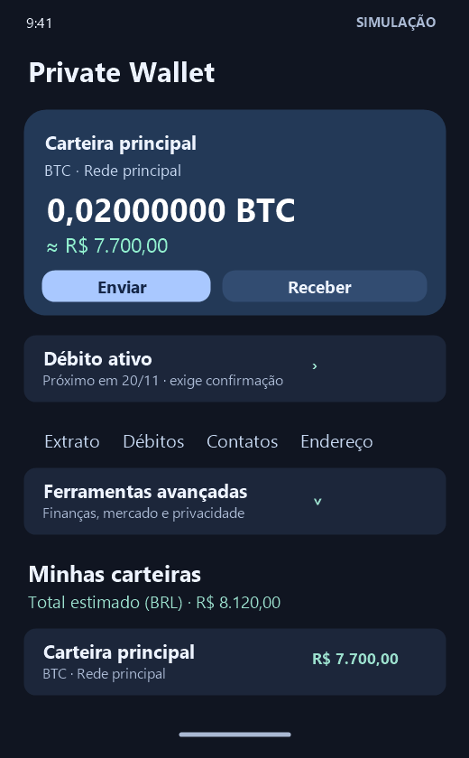
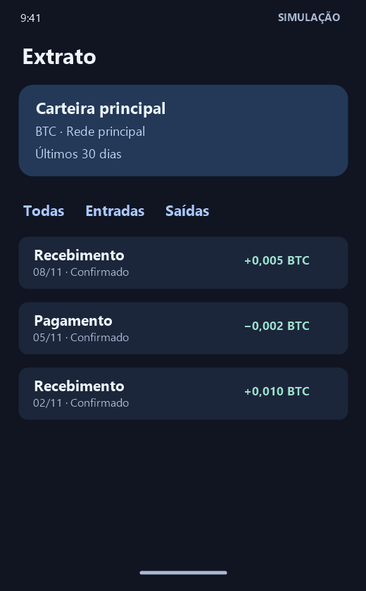
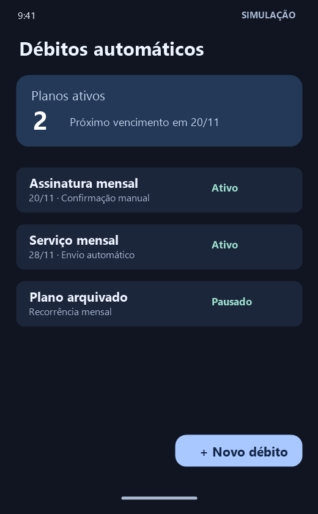
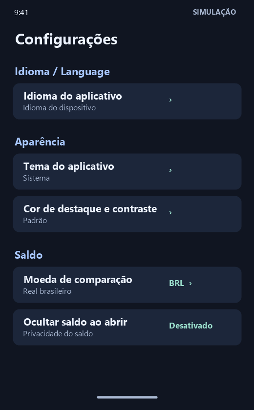

# PrivateWallet

[](https://flutter.dev)
[](https://dart.dev)
[](LICENSE)
[](#instalação-e-compilação)

**PrivateWallet** é uma carteira de autocustódia multiplataforma (desktop e mobile) desenvolvida em Flutter, com suporte nativo a **Bitcoin (BTC)** e **Ethereum (ETH)**. O aplicativo une soberania financeira, privacidade estrita e uma suíte completa de ferramentas bancárias e descentralizadas para o dia a dia.

Na PrivateWallet, as chaves privadas são geradas, criptografadas e mantidas exclusivamente no dispositivo do usuário. Não existem servidores intermediários, cadastros, telemetria nem custódia externa: você tem o controle matemático e absoluto sobre seus fundos.

---

## Telas do Aplicativo

Capturas reais simuladas em tema escuro, demonstrando a interface adaptativa para mobile e desktop:

| Painel da Carteira (Dashboard) | Extrato On-Chain & Histórico |
| :---: | :---: |
|  |  |
| Saldo do ativo em foco, patrimônio consolidado, aviso de débitos e atalhos rápidos. | Histórico detalhado de entradas e saídas on-chain com status de confirmação. |

| Débitos Automáticos Recorrentes | Configurações & Segurança |
| :---: | :---: |
|  |  |
| Planos recorrentes, frequência de pagamento e alternância de confirmação manual/automática. | Preferências de idioma, aparência, contraste, moedas fiduciárias e segurança. |

---

## Sumário

1. [Destaques e Princípios](#destaques-e-princípios)
2. [Instalação e Compilação](#instalação-e-compilação)
3. [Guia de Funcionalidades do Aplicativo](#guia-de-funcionalidades-do-aplicativo)
   - [3.0 Design Moderno, Clean e Sem Nomes Técnicos](#30-design-moderno-clean-e-sem-nomes-técnicos)
   - [3.1 Gerenciamento de Carteiras e Contas](#31-gerenciamento-de-carteiras-e-contas)
   - [3.2 Saldos, Valuation Patrimonial e Moedas Fiduciárias](#32-saldos-valuation-patrimonial-e-moedas-fiduciárias)
   - [3.3 Envio, Recebimento e Troca de Moedas (Swap BTC ⇄ ETH)](#33-envio-recebimento-e-troca-de-moedas-swap-btc--eth)
   - [3.4 Extrato On-Chain vs Histórico de Envios Locais](#34-extrato-on-chain-vs-histórico-de-envios-locais)
   - [3.5 Inspetor Anti-Golpe & Escudo Determinístico de Endereços](#35-inspetor-anti-golpe--escudo-determinístico-de-endereços)
   - [3.6 Otimizador de Gas & Rastreador de Mempool](#36-otimizador-de-gas--rastreador-de-mempool)
   - [3.7 Ponto de Venda (PDV) & Cobrança Rápida](#37-ponto-de-venda-pdv--cobrança-rápida)
   - [3.8 Central de Privacidade, Camuflagem & Modo Isca](#38-central-de-privacidade-camuflagem--modo-isca)
   - [3.9 Débitos Automáticos Recorrentes](#39-débitos-automáticos-recorrentes)
   - [3.10 Compras Conjuntas & Rachas Coletivos](#310-compras-conjuntas--rachas-coletivos)
   - [3.11 Módulos de Gestão Financeira Pessoal](#311-módulos-de-gestão-financeira-pessoal)
   - [3.12 Agenda Descentralizada de Contatos](#312-agenda-descentralizada-de-contatos)
   - [3.13 Sincronização P2P por QR Code & Backup Soberano](#313-sincronização-p2p-por-qr-code--backup-soberano)
   - [3.14 Segurança, Bloqueio Biométrico e Proteção de Sistema](#314-segurança-bloqueio-biométrico-e-proteção-de-sistema)
   - [3.15 Experiência Desktop Sem Moldura Nativa (Windows, Linux e macOS)](#315-experiência-desktop-sem-moldura-nativa-windows-linux-e-macos)
   - [3.16 Experiência Mobile: Barra de Pesquisa Rápida e Segurança no Topo (Android e iOS)](#316-experiência-mobile-barra-de-pesquisa-rápida-e-segurança-no-topo-android-e-ios)
   - [3.17 Suporte Multichain Descomplicado & Central de Gastos (Spending Hub)](#317-suporte-multichain-descomplicado--central-de-gastos-spending-hub)
   - [3.18 Frases Mnemônicas de Recuperação (BIP-39) & Confirmações Claras de Transação](#318-frases-mnemônicas-de-recuperação-bip-39--confirmações-claras-de-transação)
4. [Arquitetura de Software](#arquitetura-de-software)
5. [Configuração Técnica das Redes (--dart-define)](#configuração-técnica-das-redes---dart-define)
6. [Diagnóstico, Validação e Troubleshooting](#diagnóstico-validação-e-troubleshooting)

---

## Destaques e Princípios

- **Autocustódia Soberana**: Você é o único dono das suas chaves criptográficas. Nenhuma chave privada é enviada pela rede ou armazenada em servidores externos.
- **Multi-Moeda Nativo**: Gerencie Bitcoin (Native SegWit Bech32, Taproot e Legacy) e Ethereum (EIP-55 e EIP-681) em uma mesma conta unificada.
- **Redes Principais e Redes de Teste**: Alterne facilmente entre Ethereum Mainnet / Sepolia e Bitcoin Mainnet / Testnet4 para desenvolvimento e experimentação segura sem arriscar fundos reais.
- **Privacidade Extrema**: Sem KYC, sem números de telefone, sem e-mails e sem telemetria. Os nomes de usuário (`@username`) e identificadores (`PW-ID`) são gerados matematicamente a partir dos próprios endereços públicos.
- **Ferramentas de Banco Descentralizado**: Automatize pagamentos com Débito Automático, separe reservas em Cofres Virtuais sem custos on-chain, controle despesas com Orçamento Mensal e divida gastos com Compras Conjuntas.
- **Multiplataforma Unificada**: Funciona nativamente em Android, iOS, Windows, Linux e macOS, compartilhando a mesma lógica de negócio e interface adaptativa.

---

## Instalação e Compilação

### Pré-requisitos

- **Flutter SDK**: Versão 3.x com Dart 3.13.7 ou superior (conforme o intervalo declarado no `pubspec.yaml`).
- Execute `flutter doctor -v` para conferir a integridade das ferramentas da sua plataforma de destino.

### Tabela de Requisitos por Plataforma

| Plataforma | Ferramentas Necessárias | Comando de Build |
| :--- | :--- | :--- |
| **Android** | Android SDK, Command-line Tools e JDK 17+ | `flutter build apk --release` |
| **iOS** | macOS com Xcode 15+ e CocoaPods | `flutter build ios --release` |
| **Windows** | Visual Studio 2022 com a carga de C++ para Desktop e suporte a Developer Mode (Symlinks) | `flutter build windows --release` |
| **Linux** | Clang, CMake, Ninja, pkg-config, GTK 3, liblzma, libsecret-1 e libjsoncpp | `flutter build linux --release` |
| **macOS** | Xcode e ferramentas de desenvolvimento de linha de comando | `flutter build macos --release` |

### Clonagem e Execução Rápida

```bash
# 1. Clone o repositório
git clone https://github.com/aldobarduconeto/PrivateWallet.git
cd PrivateWallet

# 2. Obtenha as dependências
flutter pub get

# 3. Liste os dispositivos disponíveis
flutter devices

# 4. Execute na sua plataforma preferida (ex: windows, linux, chrome, android)
flutter run -d windows
```

> [!NOTE]
> No Ubuntu/Debian, instale os pacotes de sistema necessários com:
> `sudo apt-get install clang cmake ninja-build pkg-config libgtk-3-dev liblzma-dev libsecret-1-dev libjsoncpp-dev`

---

## Guia de Funcionalidades do Aplicativo

Esta seção explica detalhadamente cada recurso existente no PrivateWallet, seu propósito, como utilizá-lo e o que acontece por baixo dos panos.

```
┌────────────────────────────────────────────────────────────────────────┐
│                        PRIVATE WALLET - ARQUITETURA                     │
│                                                                        │
│   ┌────────────────────────────────────────────────────────────────┐   │
│   │                      PAINEL PRINCIPAL                          │   │
│   │   Saldo Ativo (BTC/ETH) • Total Fiduciário • Alerta de Débito  │   │
│   └──────┬─────────────────────┬────────────────────┬──────────────┘   │
│          │                     │                    │                  │
│          ▼                     ▼                    ▼                  │
│   ┌──────────────┐     ┌───────────────┐    ┌──────────────┐           │
│   │   OPERAÇÕES  │     │   SEGURANÇA   │    │   FINANÇAS   │           │
│   │   • Enviar   │     │   • Biometria │    │   • Conversor│           │
│   │   • Receber  │     │   • Inspetor  │    │   • Cofres   │           │
│   │   • Extrato  │     │   • Camuflagem│    │   • Metas    │           │
│   │   • PDV      │     │   • Backup QR │    │   • DCA      │           │
│   └──────────────┘     └───────────────┘    └──────────────┘           │
└────────────────────────────────────────────────────────────────────────┘
```

---

### 3.0 Design Moderno, Clean e Sem Nomes Técnicos

O layout do PrivateWallet foi redesenhado para proporcionar uma experiência visual moderna, limpa e convidativa, eliminando jargões intimidadores de desenvolvedores e termos técnicos obscuros:

- **Linguagem Humana e Acessível**: Termos complexos como *secp256k1*, *Keccak-256*, *Address Poisoning*, *Mempool*, *EIP-681* ou *Valuation Consolidado* foram substituídos por rótulos amigáveis do dia a dia:
  - *Autocustódia Soberana* → **Conta Principal (sob seu controle total)**.
  - *Cobrança Rápida & PDV* → **Cobrar com QR** (geração de QR Code para receber pagamentos no balcão ou na mesa).
  - *Monitor de Gas & Mempool* → **Taxas de Envio** (horários mais baratos para transferir).
  - *Inspetor Anti-Golpe* → **Checar Endereço Seguro** (validação preventiva contra golpes).
  - *Cofres Virtuais* → **Guardar Dinheiro (Cofres)** (reservas para metas sem taxas).
  - *Autodébito Programado* → **Pagamentos Automáticos** (agendamentos e recorrências).
  - *Extrato On-Chain* → **Histórico de Movimentações**.
- **Cartão de Saldo Principal com Ações Rápidas**:
  - Saldo exibido em destaque com tipografia limpa e botão discreto para ocultar/revelar valores.
  - Seletor moderno de moedas (pills táteis de Bitcoin e Ethereum) com indicação imediata de saldo.
  - Quatro botões principais de ação rápida com design tátil e arredondado: **Enviar**, **Receber**, **Cobrar** e **Histórico**.
- **Suas Moedas (Assets Overview)**:
  - Cards individuais de Bitcoin e Ethereum exibindo valores nativos e a equivalência aproximada na sua moeda base.
  - Alternância de moeda em uso com apenas um toque no card.
- **Serviços & Facilidades em Grade**:
  - Em vez de menus empilhados extensos, as ferramentas são organizadas em uma grade moderna e espaçosa de cards 2x4 com ícones coloridos, títulos claros e explicações em uma única linha.
- **Barra de Janela Integrada (Desktop e Mobile)**:
  - **Desktop (Windows, Linux, macOS)**: Janela sem moldura nativa com barra de título personalizada e controles minimalistas de minimizar, maximizar e fechar.
  - **Mobile (Android e iOS)**: Layout Edge-to-Edge transparente com cabeçalho adaptativo e sem duplicações de botões.
  - **Recursos Integrados no Topo**: Barra de pesquisa rápida Spotlight (`Ctrl+K` / `⌘K`), radar ao vivo de taxas de envio, alternador de saldo discreto, botão de limpeza de textos copiados da memória e atalho para checar endereços seguros.

---

### 3.1 Gerenciamento de Carteiras e Contas

O PrivateWallet permite criar e gerenciar múltiplos perfis de carteiras com diferentes configurações de chave e rede:

- **Multi-Moeda Unificada (ETH + BTC)**: É a modalidade recomendada. Gera uma única chave mestra a partir da qual são derivados um endereço Ethereum e um endereço Bitcoin (Native SegWit Bech32). Você pode alternar o ativo em foco com um único toque no painel.
- **Carteiras Específicas**: Permite criar ou importar carteiras focadas exclusivamente em Ethereum ou exclusivamente em Bitcoin.
- **Hot Wallet (Com Chaves)**: Carteira completa na qual a chave privada reside no armazenamento seguro do dispositivo (`flutter_secure_storage`). Está apta a assinar transações on-chain, executar débitos automáticos e transferir valores.
- **Cold Wallet / Observação (Watch-Only)**: Permite cadastrar qualquer endereço público externo para monitorar saldos, consultar movimentações e gerar solicitações de cobrança sem armazenar chaves privadas no dispositivo. É ideal para parear com dispositivos offline ou hardware wallets.
- **Identidade Soberana**: Cada carteira recebe um nome personalizado, um `@username` e um identificador soberano único (`PW-ID`), facilitando o compartilhamento e a identificação entre amigos sem expor dados pessoais.

---

### 3.2 Saldos, Valuation Patrimonial e Moedas Fiduciárias

- **Saldo no Ativo em Foco**: Apresentado no topo do painel na unidade nativa (BTC ou ETH).
- **Valuation Consolidado**: A seção *Minhas Carteiras* calcula uma estimativa fiduciária individual por conta e consolida o patrimônio total líquido. O cálculo soma cada par `(ativo, endereço)` de forma desduplicada para evitar contagens duplicadas entre redes.
- **Configuração da Moeda Base de Referência**: Em **Configurações → Saldo & Moeda Base de Referência**, o usuário escolhe livremente sua moeda governamental padrão (BRL, USD, EUR, GBP, ARS, JPY, entre mais de 160 opções). Essa moeda base define a exibição das estimativas de saldo no painel, o cálculo do patrimônio consolidado e o valor padrão utilizado no modo Ponto de Venda (PDV).
- **Taxas de Câmbio em Tempo Real**: As cotações fiduciárias utilizam taxas de mercado com fallback offline e atualização segura via ExchangeRate-API (base USD).
- **Privacidade de Saldo**: O ícone de visibilidade no painel oculta instantaneamente os valores na tela (`••••••`). É possível configurar para que os saldos sejam ocultados automaticamente ao abrir o app ou ao minimizar a janela.

---

### 3.3 Envio, Recebimento e Troca de Moedas (Swap BTC ⇄ ETH)

- **Receber Criptomoedas**: Gera o endereço público no formato textual e em QR Code de alta densidade. O usuário pode preencher um valor de referência para gerar um QR Code com pedido de pagamento padronizado:
  - **Bitcoin**: Padrão URI [BIP-21](https://github.com/bitcoin/bips/blob/master/bip-0021.mediawiki) (`bitcoin:<endereco>?amount=<valor>&message=<descricao>`).
  - **Ethereum**: Padrão URI [EIP-681](https://eips.ethereum.org/EIPS/eip-681) (`ethereum:<endereco>?value=<wei>&label=<descricao>`).
- **Enviar Criptomoedas**: Permite digitar o endereço manualmente, colar da área de transferência ou escanear via câmera/arquivo de imagem. O fluxo calcula a taxa de rede recomendada com o gateway da blockchain correspondente, exibe o resumo completo na confirmação e realiza a assinatura criptográfica estritamente no dispositivo antes de transmitir a transação assinada (*broadcast*).
- **Troca de Moedas (Swap BTC ⇄ ETH / Satoshis ⇄ Ether)** (`lib/screens/crypto_swap_screen.dart`):
  - Permite a troca direta e bilateral entre **Bitcoin** (em Bitcoins decimais ou em **Satoshis**) e **Ethereum** (em Ether ou Wei).
  - Suporta alternância dinâmica de unidade para Bitcoin (`[BTC]` ou `[Satoshis (sats)]`).
  - Cotação em tempo real baseada em mercado descentralizado com cálculo de taxa de liquidez e proteção de slippage (tolerância máxima configurável).
  - Em contas unificadas Multi-Moeda, os fundos de destino são creditados diretamente no endereço correspondente da mesma conta.
  - Registro contábil completo no histórico de atividades locais e emissão de Comprovante Bancário Oficial de Troca.

---

### 3.4 Extrato On-Chain vs Histórico de Envios Locais

O aplicativo separa claramente duas visões complementares de movimentação:

1. **Extrato On-Chain (`lib/screens/wallet_statement_screen.dart`)**:
   - Consulta diretamente os nós indexadores da rede (Esplora para Bitcoin e RPC para Ethereum).
   - Exibe **todas** as entradas e saídas associadas ao endereço, inclusive valores recebidos de terceiros ou transações disparadas de outros dispositivos.
   - Fornece filtros por status (confirmadas, pendentes na mempool, falhas), detalhes do bloco, contagem de confirmações e links diretos para exploradores de blocos.

2. **Histórico de Envios Locais (`lib/screens/wallet_activity_screen.dart`)**:
   - Registra as transferências disparadas a partir **deste aplicativo/aparelho**.
   - Permite emitir e compartilhar o **Comprovante Oficial Formatado**, contendo Hash da transação (TXID), remetente, destinatário, nome do contato salvo, taxa de mineração paga e data.

---

### 3.5 Inspetor Anti-Golpe & Escudo Determinístico de Endereços

Golpes de envenenamento de endereço (*Address Poisoning*) e enganos ao alternar redes são as maiores causas de perda de fundos no ecossistema cripto. O **Inspetor Anti-Golpe** (`lib/widgets/address_inspector_dialog.dart`) atua como uma barreira preventiva:

- **Auditoria de Rede e Formato**: Detecta se um endereço colado pertence à rede errada (por exemplo, colar um endereço Ethereum na carteira Bitcoin ou colar um endereço de rede principal na rede de testes).
- **Validação de Checksum**: Valida a integridade do checksum EIP-55 para Ethereum e a decodificação Bech32 / Base58Check para Bitcoin.
- **Identificação de Tipo de Script Bitcoin**: Informa se o endereço é Legacy (P2PKH), SegWit compatível (P2SH), Native SegWit (Bech32 - menores taxas) ou Taproot (Bech32m - máxima eficiência e privacidade).
- **Escudo Determinístico de Emojis**: Converte o hash criptográfico do endereço em uma sequência única de emojis visuais. Isso permite ao usuário bater o olho e conferir a autenticidade do endereço sem precisar comparar dezenas de caracteres hexadecimais.

---

### 3.6 Otimizador de Gas & Rastreador de Mempool

O monitor de taxas (`lib/screens/gas_tracker_screen.dart`) ajuda o usuário a economizar fundos evitando horários de pico:

- **Taxas Ethereum (Gwei)**: Apresenta os níveis Econômico (baixa prioridade), Padrão e Rápido, estimando o tempo de inclusão no bloco e o custo aproximado da transação básica em moeda fiduciária.
- **Taxas Bitcoin (sat/vB)**: Acompanha a ocupação da Mempool em satoshis por byte virtual para inclusão nos blocos seguintes.
- **Alarme de Gas Personalizável**: Permite definir um valor-alvo em Gwei. O aplicativo monitora a rede e alerta o usuário assim que o custo de transação cair abaixo do limite desejado.

---

### 3.7 Ponto de Venda (PDV) & Cobrança Rápida

O modo **Cobrança Rápida & PDV** (`lib/screens/crypto_pos_screen.dart`) transforma o dispositivo em um terminal de cobranças descentralizado para comércios, prestadores de serviço ou vendas casuais:

> [!IMPORTANT]
> **Atenção — Não é uma exchange / rampa fiat (on-ramp)**: O aplicativo **não compra, vende nem converte dinheiro governamental em criptomoeda**. O modo PDV apenas calcula matematicamente e exibe o **valor equivalente** em BTC ou ETH a partir do preço informado na moeda base configurada (ou em outra moeda governamental selecionada na tela), gerando uma solicitação de pagamento em QR Code padronizada ([BIP-21](https://github.com/bitcoin/bips/blob/master/bip-0021.mediawiki) ou [EIP-681](https://eips.ethereum.org/EIPS/eip-681)). O pagador transfere os criptoativos diretamente da carteira dele para a sua pela blockchain.

1. O vendedor digita o valor desejado na sua moeda governamental (o app utiliza a moeda base definida nas configurações, como R$, US$ ou EUR, mas permite alternar para qualquer outra moeda suportada).
2. O aplicativo consulta a cotação do ativo em foco (BTC ou ETH) e calcula instantaneamente a fração **equivalente** de criptomoeda.
3. Um QR Code de pagamento é gerado na tela com o endereço da carteira e a quantidade exata de satoshis ou wei a ser transferida.
4. O cliente escaneia com qualquer carteira compatível e transfere os fundos diretamente via blockchain, sem maquininhas, sem intermediários financeiros e sem taxas de adquirência.

---

### 3.8 Central de Privacidade, Camuflagem & Modo Isca

A Central de Privacidade (`lib/screens/privacy_stealth_screen.dart`) oferece defesas proativas para o uso em público e segurança pessoal:

- **Diagnóstico e Score de Blindagem**: Avalia a configuração do aplicativo (biometria ativa, bloqueio em segundo plano, modo observador) e atribui uma pontuação de proteção de 0 a 100%.
- **Modo Discreto / Camuflagem**: Substitui saldos e patrimônio por asteriscos (`••••••`) para evitar olhares curiosos (*shoulder surfing*) em locais públicos e transporte.
- **Ofuscação de Endereços**: Abrevia visualmente as chaves públicas na interface para impedir que câmeras de vigilância capturem seus endereços on-chain.
- **Modo Isca / Coação (Decoy Mode)**: Em caso de coação ou risco à integridade física, permite alternar para uma exibição demonstrativa fictícia com saldos mínimos, protegendo os fundos reais do usuário.

---

### 3.9 Débitos Automáticos Recorrentes

O módulo de **Débito Automático** (`lib/screens/wallet_auto_debit_screen.dart`) resolve o problema de assinaturas e pagamentos recorrentes (aluguéis, mensalidades, doações) em um ambiente soberano:

- **Configuração do Plano**: Define o destinatário, ativo (BTC ou ETH), valor do ciclo e periodicidade (diária, semanal, quinzenal ou mensal).
- **Modos de Execução**:
  - *Com Confirmação Manual (Padrão)*: O aplicativo emite um lembrete 24 horas antes do vencimento e exibe um aviso destacado no painel. O envio só ocorre quando o usuário toca e confirma a transação.
  - *Envio Automático*: Caso a carteira possua a chave privada de assinatura e o usuário ative a execução automática, o aplicativo tenta assinar e transmitir o pagamento no momento do vencimento durante os ciclos de sincronização em segundo plano.
- **Controle Total**: Qualquer débito pode ser pausado, reativado, antecipado manualmente ou excluído instantaneamente com um toque.

---

### 3.10 Compras Conjuntas & Rachas Coletivos

O módulo de **Compras Conjuntas** (`lib/screens/group_purchases_screen.dart`) organiza despesas compartilhadas (almoços de equipe, viagens, compras comunitárias):

- Criação do racha com valor total e título da despesa.
- Seleção de múltiplos amigos salvos na agenda de contatos ou inserção por endereço / `PW-ID`.
- Divisão automática e proporcional de cotas entre os participantes.
- Painel de status em tempo real com barra de progresso, indicando quais participantes já quitaram sua fração e gerando links de cobrança personalizados.

---

### 3.11 Módulos de Gestão Financeira Pessoal

A tela de **Finanças & Gestão Patrimonial** (`lib/screens/wallet_finance_screen.dart`) agrega utilitários estratégicos:

- **Conversor Instantâneo & Valuation**: Calcula na hora a equivalência entre qualquer quantidade de BTC/ETH e moedas fiduciárias (BRL e USD), exibindo o patrimônio líquido da carteira.
- **Cofres Virtuais ("Caixinhas")**: Permitem segregar parcelas do saldo para propósitos específicos (ex: "Reserva de Emergência", "IPVA", "Taxas de Gas"). **Importante**: Os cofres realizam uma trava lógica local no saldo da carteira, permitindo organizar suas economias sem gastar taxas de mineração na blockchain.
- **Metas Financeiras**: Permite cadastrar alvos de acúmulo de criptoativos (ex: acumular 0.25 BTC ou 2.0 ETH) e exibe uma barra de progresso baseada no saldo real atual da carteira.
- **Orçamento Mensal de Gastos**: Define um teto de despesas para o mês. O app computa as saídas registradas e avisa visualmente caso você atinja 80% ou ultrapasse o limite estipulado.
- **Simulador DCA (Dollar-Cost Averaging)**: Ferramenta de simulação matemática que projeta o resultado histórico e composto de compras recorrentes regulares (semanais ou mensais) em comparação com compras únicas pontuais.

---

### 3.12 Agenda Descentralizada de Contatos

A **Agenda de Contatos** (`lib/screens/wallet_contacts_screen.dart`) elimina a necessidade de redigitar ou copiar endereços complexos:

- Permite cadastrar amigos, parceiros e empresas com nome, `@username` e endereços de Bitcoin e Ethereum.
- Suporta leitura via câmera, escaneamento de arquivos de imagem salvos no aparelho ou importação de cartões de contato criptográficos (`pw://contact`).
- Integração direta com os fluxos de envio, compras conjuntas e débitos automáticos.

---

### 3.13 Sincronização P2P por QR Code & Backup Soberano

Para transferir dados entre aparelhos (ex: computador e celular) sem usar servidores em nuvem:

- **Exportação Cifrada**: O aparelho de origem gera um pacote de dados protegido com criptografia de padrão militar **AES-GCM de 256 bits**, acompanhado de um código temporário de autorização que expira em 10 minutos.
- **Modos de Transferência**:
  - *Hot Wallet (Com Chaves)*: Migra o material completo de assinatura da carteira para o novo dispositivo.
  - *Cold Wallet (Espelhamento Watch-Only)*: Exporta apenas as contas e endereços públicos, transformando o segundo aparelho em uma carteira de observação segura.
- **Backup Físico Offline**: No painel de gerenciamento da carteira, o usuário pode consultar a chave privada ou semente mnemônica para anotação física offline (Paper Wallet / Placa de Metal).

---

### 3.14 Segurança Soberana (Sem E-mail ou Telefone)

O PrivateWallet adota uma arquitetura de **Segurança Soberana Criptográfica**, eliminando deliberadamente a dependência de e-mails, SMS, números de telefone ou contas em servidores em nuvem.

#### Por que carteiras soberanas NÃO utilizam e-mail nem telefone?

1. **Eliminação de Ataques de SIM Swap**: Em sistemas centralizados ou Web2, criminosos realizam engenharia social junto a operadoras de telefonia para clonar chips e interceptar códigos SMS de recuperação, drenando carteiras inteiras. Ao não usar número de telefone, o PrivateWallet é 100% imune a ataques de SIM Swap.
2. **Imunidade a Vazamentos de Bancos de Dados**: Serviços que exigem e-mail e senha centralizam credenciais em servidores remotos, que frequentemente sofrem vazamentos e expõem usuários a hackers e extorsão. No PrivateWallet, nenhum dado pessoal é coletado e não existe servidor central com suas credenciais.
3. **Bloqueio a Golpes de Phishing Direcionados**: Sem associação entre seu e-mail e seus endereços públicos, torna-se impossível para invasores enviarem links fraudulentos de "redefinição de senha" ou alertas falsos de segurança.
4. **Autocustódia Matemática Pura**: A titularidade sobre os criptoativos decorre exclusivamente da posse da chave privada criptográfica ou frase mnemônica gerada localmente. O usuário não depende de autorização de nenhuma empresa ou plataforma para movimentar seus fundos.

#### Camadas de Proteção Implementadas no Aplicativo:

- **PIN / Senha Mestra Criptográfica Local**: Disponível tanto no Mobile quanto no Desktop. A autenticação utiliza derivação com sal criptográfico de 128 bits gerado por CSPRNG (`Random.secure()`) e hash SHA-256 no armazenamento seguro do dispositivo (`flutter_secure_storage`).
- **Proteção Anti-Força Bruta (Rate Limiting Local)**: O aplicativo monitora tentativas de acesso consecutivas. Após 3 tentativas falhas, ativa bloqueio temporário com delay progressivo automático (5s, 30s e até 300s), impedindo tentativas automatizadas de adivinhação de PIN por softwares invasores.
- **PIN de Coação (Duress PIN / Anti-$5 Wrench Attack)**: Caso o usuário seja fisicamente coagido ou ameaçado a desbloquear o aplicativo, ao digitar o *PIN de Coação*, o app desbloqueia **silenciosamente no Modo Isca (Decoy Mode)**. O agressor verá apenas uma carteira demonstrativa secundária com fundos fictícios mínimos, sem qualquer aviso visual ou sonoro de alerta.
- **Proteção de Memória e Área de Transferência (Clipboard Guard)**: Ao copiar endereços, comprovantes ou chaves de recuperação, o app agenda a limpeza automática da área de transferência do sistema operacional após 45 segundos, impedindo que outros aplicativos espiões leiam chaves deixadas na memória.
- **Escudo Determinístico Anti-Poisoning**: Converte o hash Keccak-256 dos endereços em uma sequência única de 4 emojis visuais, permitindo conferência instantânea contra malwares de substituição de endereço.
- **Camuflagem e Modo Discreto**: Ocultação rápida de saldos (`••••••`) e ofuscação de chaves públicas para proteção contra curiosos e filmagem por câmeras em público (*anti-shoulder surfing*).
- **Bloqueio ao Minimizar / Segundo Plano**: Encerra a sessão imediatamente sempre que o app for minimizado ou sair de foco.
- **Backup Físico Soberano**: Preservação das sementes mnemônicas e chaves privadas estritamente offline (em papel ou placa de metal), sem sincronização em nuvens comerciais (Google Drive, iCloud ou Dropbox).

---

### 3.15 Experiência Desktop Sem Moldura Nativa (Windows, Linux e macOS)

Nas edições de computador (**Windows**, **Linux** e **macOS**), o aplicativo opera em modo **sem moldura nativa (frameless window)**:

- **Remoção das Barras Nativas**: A barra de título padrão do Windows (DWM Caption), o HeaderBar do Linux (GTK) e a TitleBar com botões *traffic lights* do macOS foram completamente desativados, permitindo que o design system do PrivateWallet preencha o canvas da janela de ponta a ponta.
- **Barra de Controle Customizada e Limpa ("Sem Frufru")**:
  - Altura compacta (38px) com visual refinado, sem decorações excessivas, perfeitamente integrada aos temas claro e escuro.
  - **Barra de Pesquisa Global & Paleta de Comandos (Spotlight / Omnibar)**: Acesso instantâneo a todas as ferramentas, telas e ações de segurança via atalho `Ctrl+K` (ou `⌘K` no macOS) ou clique direto no campo de busca central. Navegação completa por teclado (`↑↓`, `Enter`, `ESC`).
  - **Badge de Status de Rede**: Indicador sutil e dinâmico da rede conectada (ex.: `● Sepolia / Testnet` ou `● Mainnet`).
  - **Monitor Rápido de Gas**: Pill em tempo real exibindo a tarifa de gas estimada da rede (`⛽ 24 Gwei`). Um clique abre diretamente o Monitor de Taxas.
  - **Inspetor Anti-Golpe Integrado**: Botão direto para auditar e validar qualquer endereço on-chain contra riscos de *Address Poisoning*.
  - **Limpeza Rápida de Memória (Clipboard Purge)**: Botão de segurança para purgar imediatamente qualquer dado confidencial ou chave da área de transferência do SO.
  - **Alternador de Modo Discreto**: Botão de olho para ocultar/revelar valores de saldos na tela com um único clique.
  - **Botões de Controle de Janela**: Minimalistas e ergonômicos — **Minimizar** (`―`), **Maximizar/Restaurar** (`□` / `❐`) e **Fechar** (`✕`) com realce hover em vermelho.
- **Interação Nativa Completa**:
  - **Arrasto de Janela**: Clique e arraste em qualquer espaço vazio da barra superior para mover a janela com suporte total a *Aero Snap* no Windows, reposicionamento suave no Linux (X11/Wayland) e arrasto dinâmico no macOS.
  - **Duplo Clique**: Maximiza ou restaura a janela instantaneamente.
  - **Sombras e Cantos Arredondados**: A janela preserva sombras nativas (DWM/Compositor) e cantos arredondados do Windows 11 e macOS.

---

### 3.16 Experiência Mobile: Barra de Pesquisa Rápida e Segurança no Topo (Android e iOS)

Nos sistemas móveis (**Android** e **iOS**), a interface foi aprimorada com as mesmas capacidades ergonômicas de produtividade e segurança do desktop, adaptadas ao toque:

- **Barra de Pesquisa Rápida (Spotlight Mobile)**: Localizada no topo do painel principal e também acessível pelo ícone de busca na barra superior. Ao tocar, abre a paleta de comandos responsiva com filtro em tempo real de todas as 14 ferramentas, telas e operações da carteira.
- **Monitor Rápido de Gas no Cabeçalho**: Um badge em tempo real (`⛽ 24 Gwei`) posicionado no topo da tela do celular. Permite conferir o congestionamento da rede on-chain em segundos e abrir o Radar de Gas com um único toque.
- **Barra de Ações Imediatas de Segurança**:
  - **Camuflagem / Modo Discreto (`👁`)**: Oculta ou revela imediatamente todos os valores monetários em tela (`••••••`).
  - **Purga de Clipboard (`🧹`)**: Limpa instantaneamente a memória da área de transferência do celular, evitando que outros aplicativos capturem chaves ou endereços copiados.
  - **Inspetor Anti-Golpe (`🛡️`)**: Abre o auditor de endereços on-chain para validação imediata de formato, rede, checksum e emojis anti-poisoning.
- **Badge de Status de Rede**: Exibição da rede ativa (`● Sepolia` ou `● Mainnet`) diretamente no topo do painel.

---

### 3.17 Suporte Multichain Descomplicado & Central de Gastos (Spending Hub)

- **Suporte Multichain sem Complexidade**: Acesso unificado a múltiplas criptomoedas em um único aplicativo, eliminando a necessidade de múltiplos apps ou configurações técnicas de RPC e Chain IDs. Suporte integrado a **Bitcoin (BTC/Satoshis)**, **Ethereum (ETH/Wei)**, **Tether USD (USDT)** e **Solana (SOL)** com consolidação patrimonial em tempo real.
- **Central de Gastos Cripto no Dia a Dia (`lib/screens/crypto_spending_screen.dart`)**:
  - **Vales-Presente & Gift Cards**: Compre vouchers das principais marcas (iFood, Uber, Mercado Livre, Spotify, Netflix, Steam, Airbnb) com débito direto em Bitcoin ou Ethereum.
  - **Pagamento de Boletos Bancários**: Pague contas de consumo (luz, água, internet, condomínio) com conversão automática de cripto.
  - **Recarga de Celular**: Recarregue operadoras (Vivo, Claro, TIM) debitando satoshis ou wei instantaneamente.

---

### 3.18 Frases Mnemônicas de Recuperação (BIP-39) & Confirmações Claras de Transação

- **Frases de Recuperação Mnemônicas (BIP-39)** (`lib/services/bip39_service.dart` e `lib/widgets/recovery_phrase_dialog.dart`):
  - Suporte completo a frases de **12 e 24 palavras** com vocabulário oficial de 2048 palavras padronizadas.
  - Derivação determinística das chaves privadas para Ethereum e Bitcoin a partir da semente mnemônica.
  - Importação de carteiras tanto por chave privada hexadecimal quanto por frases de 12 ou 24 palavras.
  - Backup visual com grade numerada, proteção contra *shoulder surfing* (revelar/ocultar) e **teste interativo de verificação (Quiz)** para garantir que o usuário anotou suas palavras com segurança.
- **Confirmações Claras de Transação (`lib/widgets/clear_transaction_confirmation_dialog.dart`)**:
  - Modal de conferência visual completa antes de qualquer assinatura e transmissão on-chain:
  - Exibição destacada de valores em cripto e fiduciário, identificadores de contato, emojis determinísticos anti-golpe, taxa de rede com estimativa de tempo e checagem preventiva contra *Address Poisoning*.
  - Confirmação explícita em dois passos para evitar envios acidentais.

---

## Arquitetura de Software

O código segue padrões rigorosos de desacoplamento, separando apresentação, estado, regras de negócio e infraestrutura de rede:

```
lib/
├── app.dart                   # Configuração global de MaterialApp e temas
├── main.dart                  # Ponto de entrada, inicialização de plugins e bindings
├── blockchain/                # Signers locais, codecs de endereço, formatação e parsers
│   ├── bitcoin_codec.dart     # Codificação e validação Bech32 / Base58
│   ├── bitcoin_signer.dart    # Assinatura de transações Bitcoin
│   ├── ethereum_codec.dart    # Checksum EIP-55 e decodificação EIP-681
│   └── ethereum_signer.dart   # Assinatura criptográfica secp256k1 para Ethereum
├── controllers/               # Controladores de estado e regras reativas (ChangeNotifier)
│   ├── wallet_controller.dart # Gestão de contas, seleção ativa e consulta de saldo
│   ├── auto_debit_controller.dart
│   ├── budget_controller.dart
│   ├── contacts_controller.dart
│   ├── goals_controller.dart
│   ├── group_purchase_controller.dart
│   └── statement_controller.dart
├── models/                    # Modelos de domínio imutáveis e serialização
├── screens/                   # Telas principais da interface
│   ├── wallet_home_screen.dart        # Painel central, cards de saldo e atalhos
│   ├── wallet_finance_screen.dart     # Módulo bancário: conversor, cofres, metas, DCA
│   ├── wallet_auto_debit_screen.dart  # Gestão de débitos automáticos
│   ├── wallet_statement_screen.dart   # Extrato on-chain e movimentações de rede
│   ├── wallet_activity_screen.dart    # Histórico de envios locais e comprovantes
│   ├── crypto_pos_screen.dart         # Terminal Ponto de Venda (PDV)
│   ├── gas_tracker_screen.dart        # Monitor de Gas e taxas de rede
│   ├── privacy_stealth_screen.dart    # Central de privacidade e modo isca
│   └── wallet_sync_screen.dart        # Sincronização e exportação P2P por QR
├── services/                  # Infraestrutura, rede, criptografia e persistência
│   ├── blockchain/            # Gateways RPC Ethereum e Esplora Bitcoin
│   ├── storage/               # Stores de persistência com flutter_secure_storage
│   └── system/                # Biometria, notificações e integridade
├── theme/                     # Definições de paleta de cores e tipografia
└── widgets/                   # Componentes visuais reutilizáveis e diálogos modais
```

---

## Configuração Técnica das Redes (--dart-define)

O PrivateWallet conecta-se por padrão a nós públicos de alta disponibilidade. Para máxima soberania ou conexão com seu próprio nó local (como um nó Bitcoin Core com Esplora ou um nó Ethereum Geth/Nethermind), você pode substituir os endpoints no momento da compilação ou execução utilizando parâmetros `--dart-define`:

| Parâmetro `--dart-define` | Rede Correspondente | Endpoint Padrão |
| :--- | :--- | :--- |
| `ETHEREUM_MAINNET_RPC_URL` | Ethereum Mainnet | RPC público Cloudflare / Infura |
| `ETHEREUM_SEPOLIA_RPC_URL` | Ethereum Sepolia (Testnet) | RPC público Sepolia |
| `BITCOIN_MAINNET_ESPLORA_URL` | Bitcoin Mainnet | Indexador Esplora Blockstream / Mempool.space |
| `BITCOIN_TESTNET4_ESPLORA_URL` | Bitcoin Testnet4 (Testnet) | Indexador Esplora Testnet4 |

### Exemplo de Inicialização com RPC Próprio:

```bash
flutter run -d windows \
  --dart-define=ETHEREUM_SEPOLIA_RPC_URL=https://sepolia.infura.io/v3/SEU_ID_AQUI \
  --dart-define=BITCOIN_MAINNET_ESPLORA_URL=https://mempool.space/api
```

---

## Diagnóstico, Validação e Troubleshooting

### Comandos de Validação do Código

```bash
# Verificar ambiente de compilação
flutter doctor -v

# Obter dependências
flutter pub get

# Verificar formatação do código Dart
dart format --output=none --set-exit-if-changed lib

# Executar análise estática de integridade
flutter analyze
```

### Guia Rápido de Solução de Dúvidas Comuns

| Sintoma | Causa Mais Provável | Solução Recomendada |
| :--- | :--- | :--- |
| **Saldo exibido como "Indisponível"** | Instabilidade momentânea no nó indexador ou ausência de conexão com a internet. | Puxe a tela para baixo para forçar atualização ou configure um RPC alternativo via `--dart-define`. |
| **Valor fiduciário (R$) indisponível** | A API de câmbio não retornou cotação no ciclo atual. | O aplicativo usa cache offline temporário; certifique-se de que a conexão à internet esteja ativa ao inicializar. |
| **Lembretes de débito automático ausentes** | O sistema operacional restringiu notificações ou suspendeu o processo do app. | Acesse as permissões do sistema no aparelho e autorize a execução e notificações para o PrivateWallet. |
| **QR Code inválido na sincronização** | O código expirou (tempo limite de 10 minutos) ou o QR é de outro fluxo. | Gere um novo pacote de sincronização no aparelho emissor e escaneie imediatamente. |
| **Erro de Symlinks no Windows** | O Modo de Desenvolvedor do Windows não está ativo. | Ative o *Modo de Desenvolvedor* nas configurações do Windows para permitir criação de links simbólicos pelos plugins C++. |

---

## Licença

Este projeto é disponibilizado sob a licença [MIT](LICENSE). Você é livre para estudar, modificar, distribuir e compilar o código de acordo com os termos da licença.
